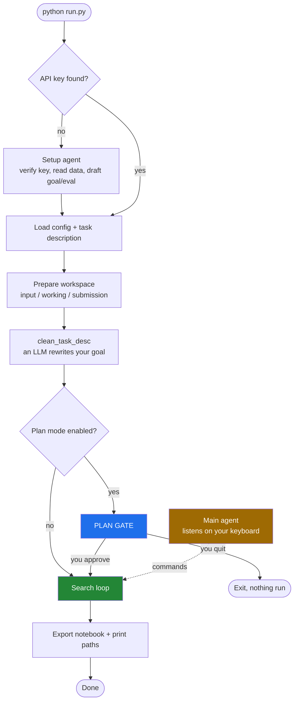
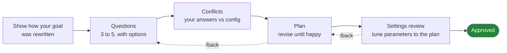
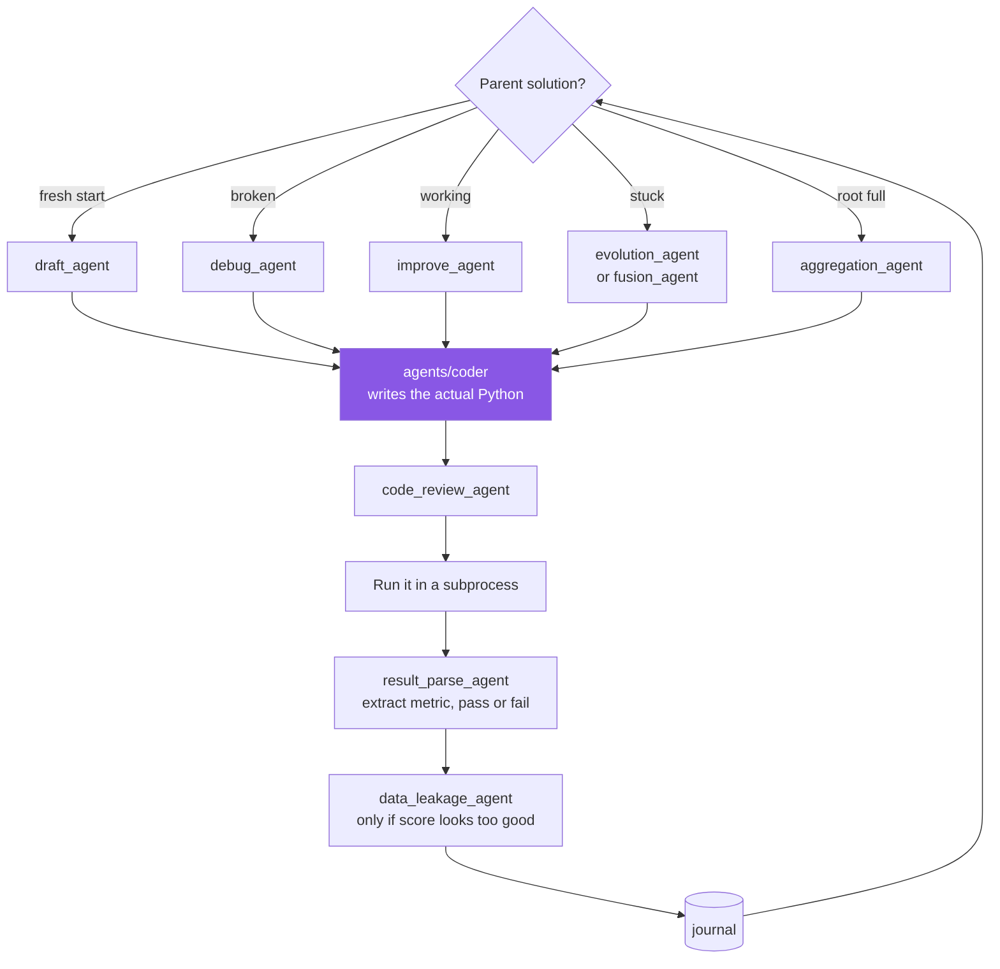
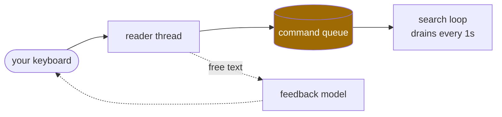

# MLEvolve Workflow

How the pieces fit together, from launching the program to getting a notebook.

---

## The short version

Think of it like hiring a builder.

| Stage | Who | What they do |
|---|---|---|
| 1 | **Setup agent** | Intake desk. First run only. Gets your API key working, reads your data, drafts the job description. |
| 2 | **Plan mode** | The meeting before work starts. Asks questions, writes a plan, waits for your approval. |
| 3 | **The search** | The crew. Many workers trying different solutions in parallel. |
| 4 | **Main agent** | Phone line to the site. Stays open while they work. |

**The one connection that matters:** what you approve in stage 2 gets glued onto the
job description that every worker in stage 3 reads. Without that, the plan would be a
document you looked at once.

**The one rule that matters:** nobody is interrupted mid task. Say `stop` and they
finish what is in their hands, save it, then stop.

---

## Overall flow

---

## Stage 2: the plan gate

Three phases. `/back` steps you to the previous one.

At every prompt you can type a command or plain text. The slash is optional.

| | |
|---|---|
| `/ask <text>` | answer my question, change nothing |
| `/change <text>` | request a change |
| `/back` | previous phase or question |
| `/skip` `/go` `/quit` `/help` | |

Anything unrecognised asks again. It never guesses.

---

## Stage 3: the search loop

One "step" picks an agent based on the state of the solution it is building on.

**None of the five agents write code.** Each builds a differently framed prompt and hands
it to `agents/coder`. What makes them different is what goes in the prompt: novelty
pressure for drafts, error context for debug, branch history for evolution.

---

## Stage 4: the main agent

Runs beside the loop, never inside it.

| Command | Effect |
|---|---|
| `status` | progress, best score, elapsed |
| `seed <path>` | start a draft from a file you edited |
| `stop` | finish running steps, save, exit |
| `abort` | kill training immediately, then exit |

Free text is answered by the model on the reader thread, so the search never waits on it.

---

## Which model does what

Two models are configured. Work is split by cost.

| Model | Used for |
|---|---|
| **code** (`agent.code`) | writing solutions, drafting questions and plans, reviewing code |
| **feedback** (`agent.feedback`) | reading results, classifying what you typed, answering your questions |
| **no model** | settings arithmetic, command parsing |

That last row is deliberate. The code model failed to notice that `exec.timeout` was nine
times larger than `agent.time_limit`, so those checks are plain arithmetic instead.

---

## What connects everything

- **`cfg`** — written by setup, tuned in the gate, read by every agent
- **`task_desc`** — the gate's output is the search's input
- **`ControlBus`** — the only channel open once the search starts
